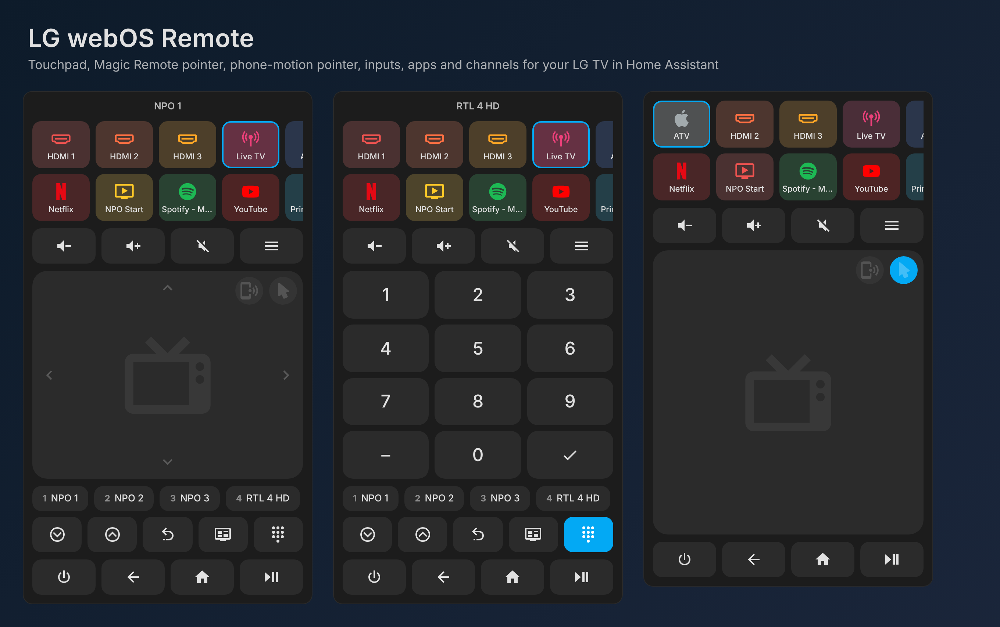
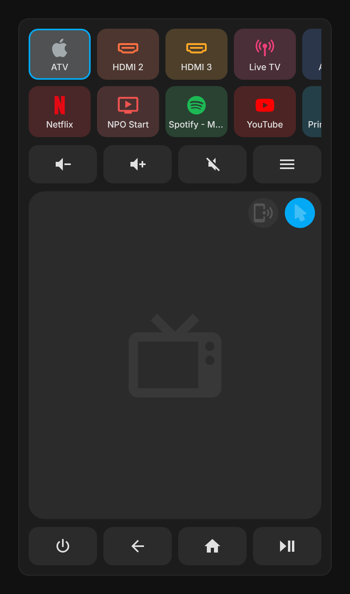
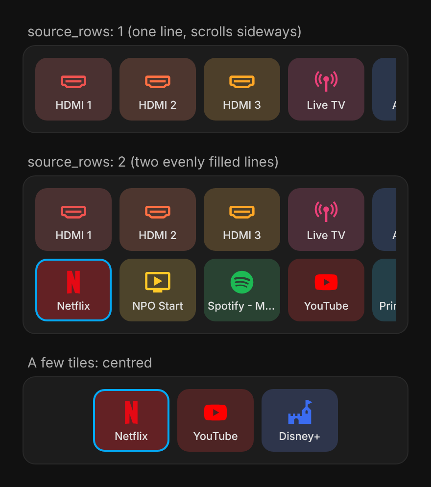
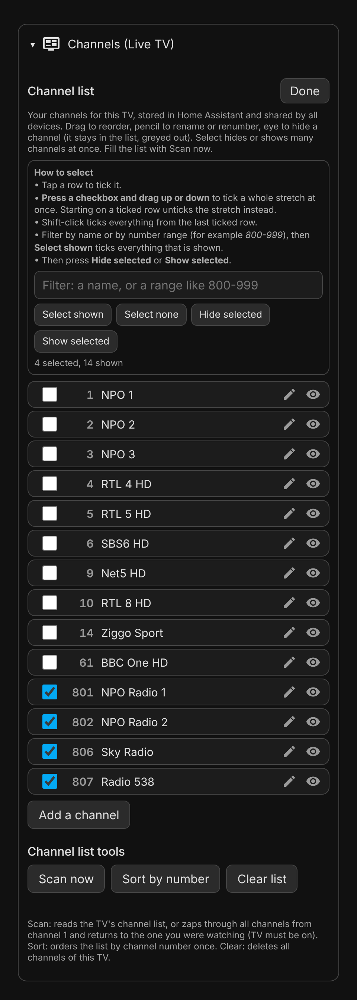

# LG webOS Remote for Home Assistant

[](https://hacs.xyz)
[](https://www.home-assistant.io)
[](LICENSE)

A phone remote for your **LG webOS TV**, as a Home Assistant dashboard card: a **touchpad**, a **Magic Remote pointer**,
a **phone-motion (air) pointer**, tiles for your **inputs and apps**, and a full **Live TV** section with a channel list you
can scan, edit and hide. Everything is set up in the card's visual editor, no YAML needed.



<sub>The pictures in this README are rendered images made with the card's own code and sample data, not screenshots from a phone. They use a dark theme; the card in your dashboard follows your own theme.</sub>

## Features

- **Touchpad**: swipe = arrow keys (they repeat while you keep dragging), tap = OK, tap near an edge = that arrow.
- **Magic Remote pointer**: drag moves the TV cursor (with acceleration), tap = click.
- **Motion pointer**: turn or tilt your phone to move the cursor, like a real Magic Remote.
- **Inputs and apps as tiles**: HDMI inputs, Live TV, extra inputs (AV, component, USB ...), and every app your TV lists. Big
  services get their icon and brand colour, everything else a neutral icon and its own colour.
- **Live TV**: current channel name, channel up/down, previous channel, TV guide, a number keypad and buttons for your favourite
  channels.
- **Channel list**: scan it from the TV in one press, reorder, rename, hide channels (many at once), add your own.
- Volume, mute, menu, back, home, play/pause and power, haptics on taps, one card per TV for several TVs.
- Nothing to install on the TV, no dashboard resource to add: the card loads itself.

## Requirements

- Home Assistant **2024.8** or newer.
- The core **LG webOS TV** integration, set up for your TV (this integration builds on it and reuses its connection).
- For the **motion pointer** your phone needs a motion sensor and Home Assistant must be opened over **https** (a browser rule
  for motion sensors). iOS asks for permission once.

## Installation

### HACS / Marketplace (custom repository)

[](https://my.home-assistant.io/redirect/hacs_repository/?owner=vandalon&repository=ha-lg-webos-remote&category=integration)

The button above opens HACS / Marketplace in your Home Assistant and offers to add this repository. Or add it by hand:

1. Open **HACS** in the sidebar or Marketplace in settings (2026.11+), then the menu (three dots, top right) **> Custom repositories**.
2. Paste `https://github.com/vandalon/ha-lg-webos-remote`, choose the type **Integration** and press **Add**.
3. Close the dialog and search for **LG webOS Remote** and press **Download**.
4. **Restart Home Assistant** (Settings > System > Restart). HA asks for this after the download as well.

Updates then show up in HACS / Marketplace like any other integration; restart Home Assistant after each update, the Python part is only loaded at
startup.

### Manual (without HACS / Marketplace)

1. **Download** the package: on the repository page press **Code > Download ZIP** (or download the source of the latest release),
   and unzip it. You only need the folder `custom_components/webos_pointer`.
2. **Copy that folder** into the `custom_components` folder of your Home Assistant configuration, so that you end up with
   `config/custom_components/webos_pointer/manifest.json` (create `custom_components` if it does not exist). Ways to get there:
   - the **Samba share** add-on (the `config` share), the **File editor** or **Studio Code Server** add-on, or the **Advanced SSH** add-on;
   - on Home Assistant Container/Core simply copy it to your configuration directory, for example
     `cp -r custom_components/webos_pointer /path/to/config/custom_components/` on Linux or macOS.
3. **Restart Home Assistant** (Settings > System > Restart).
4. Continue with [Setup](#setup).

To update, replace the `webos_pointer` folder with the new version and restart Home Assistant again (the Python part is only loaded at
startup). Your channel list and card settings are kept, they are stored outside that folder.

## Setup

1. **Settings > Devices & services > Add integration > LG webOS Remote** (one click, nothing to configure).
2. Open a dashboard, **Edit dashboard > Add card**, search for **LG webOS remote** and pick your TV.
3. Open the card editor, expand **Channels (Live TV)** and press **Scan now** with the TV on (see [Channel list](#channel-list)).

```yaml
type: custom:webos-touchpad
entity: media_player.lg_tv
```

## The card

The card is the same height on every input: on Live TV the channel controls take the space, on other inputs the touchpad
grows by exactly that much, so nothing jumps.

| Live TV | Keypad | Apps and inputs, pointer mode |
|---|---|---|
|  |  |  |

- The **channel keys** are sent as the TV's own remote buttons (channel up/down, previous channel, guide, digits). Opening the
  keypad swaps it with the touchpad, so it uses the same space.
- **Pointer mode**: the arrow icon in the corner of the pad switches between arrow keys and the cursor. The icon next to it
  turns on the **motion pointer**: point the phone, hold a finger on the pad to click.
- **Several TVs**: each card sends its own `entity` with every pointer command, so each card controls its own TV.

### Inputs and apps



- **HDMI 1..N** are always shown (the TV only lists the input that is active right now) and launched directly. The name the TV
  gives an input, for example `ATV`, is picked up the first time you switch to it and remembered in that browser.
- A **Live TV** button switches to normal TV (switch it off with `live_tv: false`).
- **Extra inputs** are things the TV does not list as a source (AV/composite, component, USB, the TV home screen, a browser).
  In the editor pick them by name, or put the TV on the input with the real remote and press **Add the current input**.
- **Tiles**: `source_rows` sets the number of lines, filled as evenly as possible (10 tiles: 2 lines = 5 + 5, 3 lines =
  4 + 4 + 2). A line that is wider than the card scrolls sideways, a few tiles are centred.
- **`source_order`** is both the filter and the order: only the listed tiles are shown, in that order. Empty shows everything.
- **Colours and icons**: known services (Netflix, YouTube, Spotify, Prime Video, Disney+, Apple TV, AirPlay, Twitch, Plex, Kodi,
  Steam, broadcaster apps, HDMI, Live TV, browser, cast, USB ...) are recognised by name. Anything else gets a neutral icon and
  its own colour (the same source always gets the same one). Override with `source_icons`:

```yaml
source_icons:
  Plex: mdi:plex
  Game console: { icon: mdi:controller, color: "#107c10" }
```

Icons come from Home Assistant's built-in Material Design Icons, no image files are needed.

### Channel list

Open the card editor and expand **Channels (Live TV)**.


- **Scan now** fills the list. The scan first switches the TV to Live TV (it only keeps its channel list loaded there) and goes
  back to where you were afterwards. If the TV has a channel list, with numbers and radio channels, it is imported at once.
  Otherwise the scan tunes to channel 1, steps one channel back to find the last channel, and zaps up through all channels until
  it has read that one. It needs the TV to be on.
- **Rows**: drag the handle to reorder, the pencil renames or renumbers, the **eye hides** a channel (it stays in the list,
  greyed out, and its button disappears from the card). Holding a channel's button on the card hides it too.
- **Add a channel** adds one by hand. Channels you add yourself also get a delete button, scanned ones can only be hidden.
- **Sort by number** puts the list in channel-number order once. The list is never reordered automatically.
- **Clear list** removes everything so you can scan again. Scanning again only adds what is missing: a channel is the same
  channel when name and number match (SBS9 on 19 and on 80 are two channels).

#### Hide many channels at once

Press **Select** above the list.



- **Tap** a row to tick it, or **press a checkbox and drag up or down** to tick a whole stretch in one go. Starting on a ticked
  row unticks the stretch instead; the list scrolls along near the edges. Shift-click ticks a range on a keyboard.
- The **filter** takes a name, or a **number range** such as `800-999` (all radio channels on a cable box). **Select shown**
  ticks everything that is shown.
- **Hide selected** or **Show selected** applies it. **Done** leaves select mode.

### Pointer and motion settings

The editor has sections for the touch pointer and the motion pointer: speed sliders, left/right and up/down inversion, a dead
zone (raise it if the cursor drifts while you hold still) and an axis swap for another way of holding the phone.

## Card options

Everything below is available in the visual editor. YAML names for reference:

| Option | Default | Description |
|---|---|---|
| `entity` | required | The webOS TV media player |
| `height` | `auto` | `auto` = content-sized and constant across inputs. Or any CSS height (`70vh`, `100%` to fill a pop-up): then the touchpad takes the spare space |
| `pad_ratio` | `1.3` | Touchpad and keypad width / height, only with `height: auto` (higher = flatter) |
| `pointer` / `air_pointer` | `true` | Show the pointer toggle / the motion toggle |
| `sources` | `true` | Show tiles for the TV's sources |
| `hide_sources` | `[]` | Source names to hide |
| `source_order` | `[]` | Show only these tiles, in this order (names as shown, or `HDMI 1`). Empty = all |
| `source_style` | `tiles` | `tiles` (icon + name) or `chips` (name only) |
| `source_rows` | `1` | Number of lines, filled evenly; wider lines scroll sideways; `0` = as many lines as needed |
| `source_colors` | `true` | Colour the tiles (`false` = neutral) |
| `source_icons` | `{}` | Icon (and colour) per source name |
| `hdmi_inputs` | `3` | Number of HDMI tiles; `0` = none |
| `inputs` | `[]` | Extra inputs: `{ app_id, name?, icon? }` |
| `live_tv` | `true` | The Live TV button (also hides a Live TV source the TV lists itself when `false`) |
| `tv_controls` | `auto` | Live TV controls: `auto` (only while on Live TV), `always`, `never` |
| `keypad` | `true` | The number keypad toggle |
| `channel_sort` | `manual` | `manual` = order of your list, `number` = always show sorted by number |
| `channels` | `[]` | Extra fixed channel buttons in YAML (names or `{ name, number }`), shown before your list |
| `haptics` | `true` | Vibrate / app haptics on taps |
| `pointer_speed` | `1` | Touch pointer speed multiplier |
| `pointer_invert_x` / `pointer_invert_y` | `false` | Flip the touch pointer |
| `air_speed` | `1` | Motion pointer speed multiplier |
| `air_invert_x` / `air_invert_y` | `false` | Flip the motion pointer |
| `air_swap_axes` | `false` | Swap turn and tilt |
| `air_deadzone` | `1` | Rotation speed (deg/s) ignored as tremor |
| `swipe_step` | `46` | Pixels of dragging per arrow press in arrow mode |
| `side_port` | `8124` | Port of the optional side channel (`0` = never use it) |

## Low-latency side channel (optional)

Pointer moves normally travel over Home Assistant's websocket. When **Home Assistant itself serves https** (an SSL certificate is
configured in its `http:` settings), the integration also opens `wss://YOUR-HA-HOST:8124/pointer` in its own thread, so a busy
Home Assistant cannot make the cursor stutter. The card uses it automatically and falls back to the normal connection if it
cannot connect. Behind a reverse proxy or Nabu Casa it does not start, and everything still works. Turn it off or change the
port in the integration's **Configure** dialog (applies after a restart).

## Services

| Service | Fields | What it does |
|---|---|---|
| `webos_pointer.move` | `dx`, `dy` (-200..200), `entity_id`? | Move the Magic Remote cursor |
| `webos_pointer.click` | `entity_id`? | Click at the cursor |
| `webos_pointer.scroll` | `dx`, `dy`, `entity_id`? | Scroll under the cursor |
| `webos_pointer.scan_channels` | `entity_id` | Scan the channels now (needs the TV on) |
| `webos_pointer.sort_channels` | `entity_id`? | Sort the channel list by number once |
| `webos_pointer.clear_channels` | `entity_id`? | Empty the channel list |

`entity_id` is optional where marked: without it the first loaded LG TV (or all TVs for sort and clear) is used. The websocket
commands `webos_pointer/channels` (the TV's channel list and your list) and `webos_pointer/set_channels` are available for your own
use.

## Where things are stored

- **Channel list**: Home Assistant storage, `.storage/webos_pointer_channels` (one entry per TV, part of your backups).
- **Learned HDMI input names**: the browser's local storage, per device.
- **Card options, extra inputs, icons**: the card's YAML in your dashboard.

## Troubleshooting

- **The card is not in the picker**: restart Home Assistant after installing, make sure the integration is added, then fully
  reload the page or the app (Companion app: Settings > Debugging > Reset frontend cache).
- **Scan says the TV is off**: turn the TV on first. Scanning needs it.
- **Scan or the editor buttons say the integration is not updated**: restart Home Assistant after an update, the Python part is
  only loaded at startup.
- **Radio channels or channels beyond a number are missing**: use a TV that lists them. If the TV has no channel list the scan
  zaps with channel up, which never reaches radio channels.
- **The motion pointer does nothing**: open Home Assistant over https and allow motion access (iOS asks once).
- **The cursor stutters**: enable https on Home Assistant itself so the side channel can start, or lower `pointer_speed`.
- **An input or app tile is missing**: the TV lists only apps (and the active input). Use `hdmi_inputs` and **Extra inputs**.

## Support

Questions and bugs: [GitHub issues](https://github.com/vandalon/ha-lg-webos-remote/issues).

## License

MIT, see [LICENSE](LICENSE).
