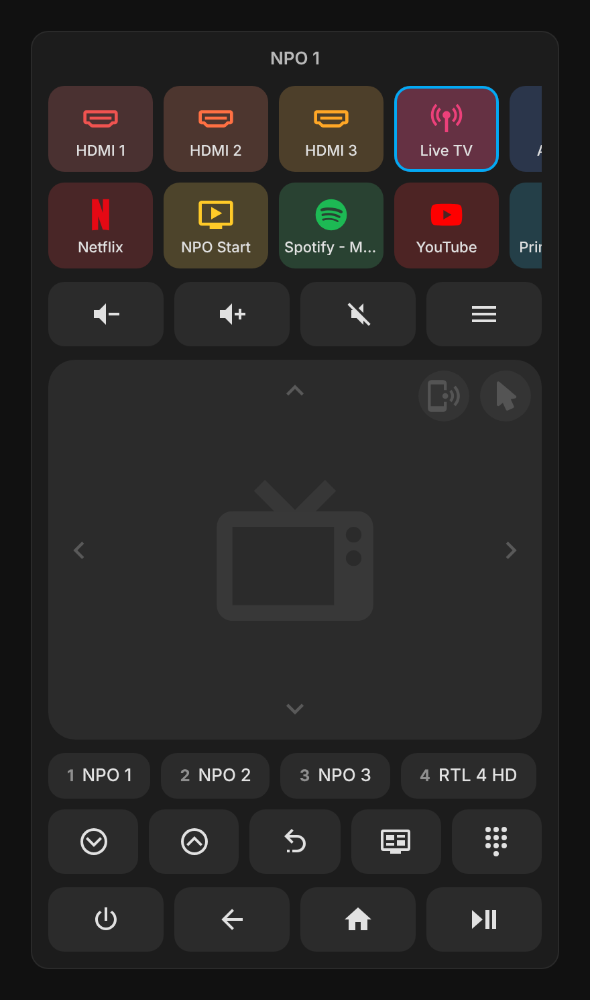
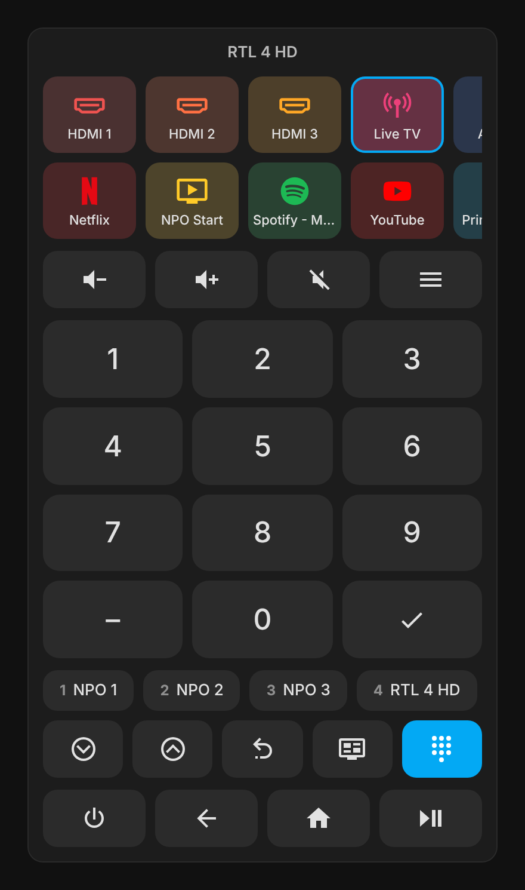
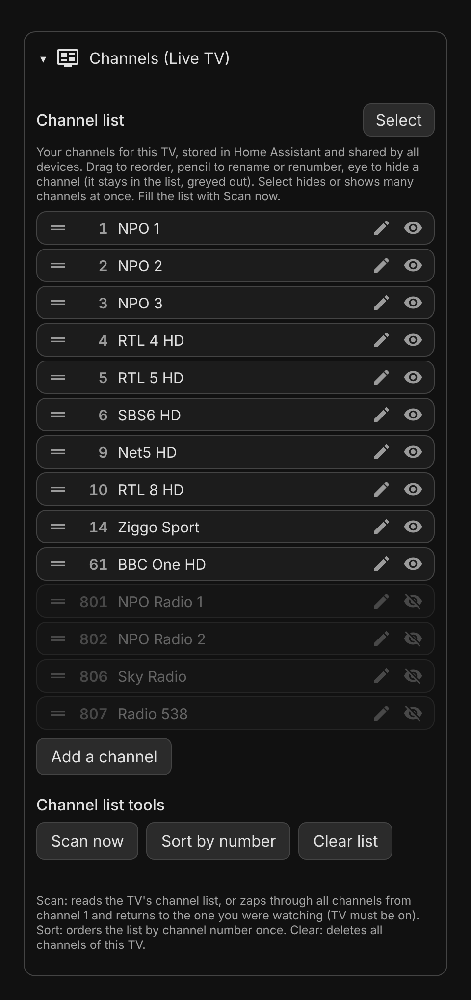

# LG webOS Remote

[](https://hacs.xyz)
[](https://www.home-assistant.io)
[](LICENSE)

A Lovelace card plus a small integration that turns a phone into a remote for an LG webOS TV: touchpad, Magic Remote
pointer, gyro ("air") pointer, source tiles, and Live TV controls with an editable channel list.

It sits on top of the core `webostv` integration and reuses its connection. Nothing runs on the TV.


<sub>Images are rendered from the card's own code with sample data, dark theme. The card follows your HA theme.</sub>

## Why

The stock media player card can't move the cursor, and the LG app is slow to open. I wanted something that opens instantly
from a dashboard pop-up and feels like the Magic Remote.

## Install

**Marketplace (HA 2026.11+):** *Settings → Marketplace → ⋮ → Custom repositories*, add
`https://github.com/vandalon/ha-lg-webos-remote` as type *Integration*, download, restart HA.

[](https://my.home-assistant.io/redirect/hacs_repository/?owner=vandalon&repository=ha-lg-webos-remote&category=integration)

**Older HA:** same steps in HACS (sidebar).

**Manual:** copy `custom_components/webos_pointer` into `config/custom_components/` and restart.

Then *Settings → Devices & services → Add integration → LG webOS Remote*. Single entry, nothing to configure.
The card registers its own frontend resource; no need to add one.

> The Python side only loads at startup. Restart HA after every update, not just reload.

## Minimal config

```yaml
type: custom:webos-touchpad
entity: media_player.lg_tv
```

Everything is in the visual editor; the YAML names are below.

## How it works

- **Touchpad (arrow mode):** drag sends arrow keys, one per `swipe_step` px, repeating while you drag. Tap = OK, tap near an edge = that arrow.
- **Pointer mode:** relative moves go to the TV's pointer input socket, with acceleration. Tap = click.
- **Air pointer:** `DeviceOrientation` deltas become cursor moves. Browsers only expose this over **https**; iOS asks for permission once.
- **Height:** the card keeps the same height on every input. On Live TV the channel controls take the space the touchpad
  otherwise grows into, so nothing jumps when you switch sources. The keypad swaps in for the touchpad, same space.
- **Several TVs:** each card sends its `entity` with every command, so one card per TV works.
- **Screen corners:** on iPhones, when the bottom row sits in the rounded screen corners (a pop-up sheet), its outer buttons
  follow the corner curve. Radii for known iPhone sizes are built in; the cogwheel slider overrides it per phone.

| Live TV | Keypad | Pointer mode |
|---|---|---|
|  |  |  |

### Sources


- The TV only reports the *active* HDMI input, so the card always shows `HDMI 1..hdmi_inputs` and launches them by app id.
  The label the TV gives an input (e.g. `ATV`) is learned the first time you switch to it and kept in `localStorage`.
- `source_order` is both filter and order. Empty = everything.
- `source_rows` spreads tiles evenly over N lines (10 tiles on 3 lines = 4/4/2). Lines wider than the card scroll sideways.
- Known apps (Netflix, YouTube, Plex, Disney+, …) get a brand icon and colour; anything else a neutral icon and a colour
  hashed from its name. Override:

```yaml
source_icons:
  Plex: mdi:plex
  Game console: { icon: mdi:controller, color: "#107c10" }
```

- `inputs` adds sources the TV doesn't list (AV, component, USB, browser). In the editor, **Add the current input** grabs
  whatever the TV is on right now.

### Channel list



**Scan now** (card editor → *Channels*) needs the TV on. It switches to Live TV (the TV only has its channel list loaded
there) and back afterwards.

- If the TV exposes a channel list, it's imported directly, numbers and radio channels included.
- If not, it tunes to channel 1, steps back once to find the last channel, then zaps up until it gets back there.
  That never reaches radio channels.

Re-scanning only adds what's missing; a channel is identified by name + number. Rows can be dragged, renamed, renumbered and
hidden; channels you added by hand can be deleted. **Select** mode does bulk hide/show (drag across the checkboxes, or filter
by a range like `800-999`). Holding a channel button on the card hides it too.


### Quick settings

The cogwheel on the pad covers pointer/air speed, swipe step, haptics, tile rows and which tiles show in which order.
Changes are written back to the card's config on the dashboard, so they apply to everyone. Admins only;
`settings_button: false` hides it.

### Low-latency side channel

Pointer moves normally go over HA's websocket. If HA itself serves **https** (cert in `http:`), the integration also starts
`wss://<host>:8124/pointer` on its own thread so a busy event loop can't make the cursor stutter. The card prefers it and
falls back silently. Behind a reverse proxy or Nabu Casa it doesn't start. Port / off switch: the integration's *Configure*
dialog (restart required).

## Options

| Option | Default | |
|---|---|---|
| `entity` | — | webOS `media_player` (required) |
| `height` | `auto` | `auto` = constant content height; any CSS height makes the pad fill the spare space |
| `pad_ratio` | `1.3` | Pad width / height with `height: auto` |
| `pad_extra` | `0` | Extra px on the pad height (`56` matches the Apple TV Remote card with `player_buttons`) |
| `side_padding` / `top_padding` / `bottom_padding` | `12` | Margins in px; `0` = none |
| `screen_corners` | `true` | Bottom row follows rounded screen corners (iOS) |
| `screen_radius` | built in | Corner radius in px: one number, or per screen size `{"402x874": 62}` |
| `show_border` | `true` | `false` for use inside a pop-up or stack with its own frame |
| `settings_button` | `true` | Cogwheel with quick settings |
| `haptics` | `true` | Vibrate on taps |
| `pointer` / `air_pointer` | `true` | Pointer / gyro toggles |
| `sources` | `true` | Source tiles |
| `hide_sources` | `[]` | Source names to hide |
| `source_order` | `[]` | Filter + order; empty = all |
| `source_style` | `tiles` | `tiles` or `chips` |
| `source_rows` | `1` | Lines of tiles; `0` = as many as needed |
| `source_colors` | `true` | `false` = neutral tiles |
| `source_icons` | `{}` | Icon / colour per source |
| `hdmi_inputs` | `3` | HDMI tiles; `0` = none |
| `inputs` | `[]` | Extra inputs `{ app_id, name?, icon? }` |
| `live_tv` | `true` | Live TV tile |
| `tv_controls` | `auto` | `auto` (Live TV only), `always`, `never` |
| `keypad` | `true` | Number keypad toggle |
| `channel_sort` | `manual` | `manual` or `number` |
| `channels` | `[]` | Fixed channel buttons (`name` or `{ name, number }`), shown before your list |
| `pointer_speed`, `pointer_invert_x/y` | `1`, `false` | Touch pointer |
| `air_speed`, `air_invert_x/y`, `air_swap_axes`, `air_deadzone` | `1`, `false`, `false`, `1` | Gyro pointer (dead zone in °/s) |
| `swipe_step` | `46` | px per arrow press |
| `side_port` | `8124` | Side channel port; `0` = never use it |

## Services

| Service | Fields | |
|---|---|---|
| `webos_pointer.move` | `dx`, `dy` (±200), `entity_id`? | Move cursor |
| `webos_pointer.click` | `entity_id`? | Click |
| `webos_pointer.scroll` | `dx`, `dy`, `entity_id`? | Scroll |
| `webos_pointer.scan_channels` | `entity_id` | Scan (TV must be on) |
| `webos_pointer.sort_channels` | `entity_id`? | Sort list by number once |
| `webos_pointer.clear_channels` | `entity_id`? | Empty the list |

Without `entity_id` the first loaded TV is used (all TVs for sort / clear). Websocket commands `webos_pointer/channels` and
`webos_pointer/set_channels` are there if you want to build on them.

## Storage

- Channel list: `.storage/webos_pointer_channels`, keyed per TV, included in backups.
- Learned HDMI labels: browser `localStorage`.
- Everything else: the card config.

## Known issues

- Tested on one TV. Channel zapping and some extra-input app ids may differ per model; issues with your model / webOS
  version are welcome.
- The air pointer needs https and a gyroscope. No fallback.

## Troubleshooting

- **Card missing from the picker:** restart HA, check the integration entry exists, hard-reload (Companion app:
  *Settings → Debugging → Reset frontend cache*).
- **"Integration not updated" in the editor:** you updated without restarting.
- **Scan says the TV is off:** it has to be on.
- **Cursor stutters:** enable https on HA so the side channel can start, or lower `pointer_speed`.
- **Tile missing:** the TV only lists apps and the active input. Use `hdmi_inputs` / `inputs`.

## Contributing

Bugs and PRs: [issues](https://github.com/vandalon/ha-lg-webos-remote/issues). This repo is exported from a larger HA
config, so PRs get applied there and re-exported.

## License

MIT
